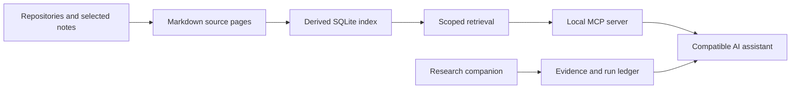

# Optimus

**Context that survives the conversation.**

Optimus is a portable memory and tool layer for AI assistants, built by [Murathan Abdullaev](https://murathan.info). It keeps project context in readable Markdown, indexes it with SQLite, and exposes focused retrieval tools through MCP.

[Explore the public showcase](https://optimus-brain-alpha.vercel.app) · [Murathan's portfolio](https://murathan.info) · [Aegis Finance showcase](https://github.com/Murathanx12/AEGIS-FINANCE-SHOWCASE)

This is an independent project under active development. Optimus supplies context and procedures to a reasoning model; it is not a newly trained language model. The public engine is separate from the owner's private brain, conversations and research archive.

## What it does

- **Preserves context:** repository structure and history, selected notes, source references and project decisions survive a session change.
- **Retrieves selectively:** domain-aware queries use a relevance threshold and can return an explicit no-match result.
- **Checks provenance:** audit reports identify source drift; deprecation records prevent obsolete facts being silently revived.
- **Serves assistants through MCP:** a local client can retrieve context and inspect historical project skills without copying the entire corpus into every prompt.
- **Works with a research companion:** durable collection state, original attachments, parsing status, coverage reports and bounded evidence reads live in a separate worker.



Markdown is the memory source of truth; the SQLite search index is rebuildable. The research companion maintains its own task ledger and original evidence archive.

## Try the engine locally

Python 3.11 or newer is required. The following PowerShell commands install a fresh local copy:

```powershell
git clone https://github.com/Murathanx12/Optimus.git
cd Optimus
python -m venv .venv
.\.venv\Scripts\python.exe -m pip install -r requirements.txt
.\.venv\Scripts\python.exe optimus.py --help
```

Start with a repository or Markdown note that you own and are comfortable indexing:

```powershell
.\.venv\Scripts\python.exe optimus.py ingest --git C:/path/to/your/project --project example
.\.venv\Scripts\python.exe optimus.py ingest --notes C:/path/to/selected-notes --project example-notes
.\.venv\Scripts\python.exe optimus.py query "your specific project question"
.\.venv\Scripts\python.exe optimus.py audit
```

Repository ingestion produces structural and history context; it does not mean that every underlying document or article has been fully read. Notes ingestion indexes explicitly selected Markdown content. Inspect source citations before relying on a returned claim.

## Connect an assistant

The checked local installation on 18 October 2026 has two servers: **7 core tools** here and **17 research tools** in the separate companion. Counts describe that installation and may change.

For a compatible local Codex or ChatGPT desktop client, register the engine in `~/.codex/config.toml` using your own absolute paths:

```toml
[mcp_servers.optimus]
command = "C:/path/to/Optimus/.venv/Scripts/python.exe"
args = ["C:/path/to/Optimus/mcp/server.py"]
```

Start a fresh session, inspect its MCP tools, then ask it to retrieve a specific project question. Core tools include `brain_query`, `session_briefing` and `aegis_skills`. The Aegis HTTP tools are installation-specific integrations; they require the configured service and do not become functional merely by cloning this repository.

The research companion adds `read_brain_page`, `run_status`, `read_evidence`, `list_personal_skills` and collection operations. It is a separate installation; this repository alone does not provide those tools. The owner's companion connection guide is `optimus-openclaw/docs/CODEX_CONNECTION.md` in that installation.

ChatGPT.com requires a separate supported connection. [Secure MCP Tunnel](https://developers.openai.com/api/docs/guides/secure-mcp-tunnels) can connect private MCP servers using outbound connectivity, subject to account, workspace and authentication setup. A static showcase website does not connect visitors to the private brain. See [official MCP client configuration](https://learn.chatgpt.com/docs/extend/mcp).

## Evidence from the research companion

A checked 18 October 2026 university internship collection captured **106 advert texts**, saved and parsed **7 original attachments**, and traversed **6 results pages twice** with matching posting sets. These are aggregate collection receipts. Personal eligibility review remained separate and incomplete; no applications were submitted by the collector.

Private adverts, original school documents, personal correspondence and authentication material are not part of this public repository or showcase.

## Repository map

| Path | Purpose |
| --- | --- |
| `optimus.py` | Ingestion, querying, auditing and deprecation CLI |
| `core/` | Store, retrieval, source ingestion and provenance checks |
| `mcp/server.py` | Local MCP interface |
| `tests/` | Engine verification |
| `examples/` | Public examples; inspect their labels before treating them as real evidence |
| `docs/` | Engineering notes and operating guidance |
| `showcase/public/` | Sanitized static architecture website; deploy this directory only |

`brain/`, `raw/`, `reports/`, local environments and secrets are ignored by Git. Keep your own exports and browser profiles outside published assets. A gitignore is a boundary for future staging, not proof that a file was never committed.

The legacy `showcase/optimus-brain/` directory already contains tracked knowledge exports (`brain.json` and selected project pages). Those files and their history have been preserved; this update does not claim they were never public. The new `showcase/public/` website is a separate, sanitized architecture demonstration and does not bundle or fetch those exports. Deploy only `showcase/public/`, rather than the repository root or the legacy directory.

## Development

```powershell
.\.venv\Scripts\python.exe -m pytest tests
```

Accumulating more text does not establish its quality or usage rights. Preserve original sources, mark uncertainty, and distinguish proposed behavior from observed results. The existing [engineering brief](CLAUDE.md) includes historical phases; current code and checked receipts determine what works today.

See [LICENSE](LICENSE).
